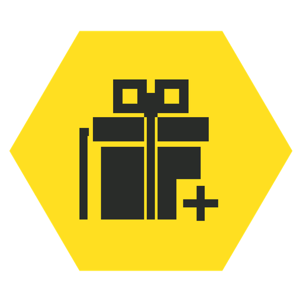

# Personal Booster

**[한국어](README.ko.md)** · [Development](docs/DEVELOPMENT.md)

A Helldivers 2 mod that keeps the game's rule of **one booster per player**, but lets you choose all of them.

With N players in the squad, your picks 1 to N are active for you, and the boosters your teammates brought are not. Teammates keep their own boosters on their own PCs. Boosters the game grants through the DSS are left as they are.

Boosters the host's game applies to the whole squad are never replaced: Increased Reinforcement Budget, Flexible Reinforcement Budget, Localization Confusion, Expert Extraction Pilot, Sample Scanner and Sample Extricator. If a teammate brings one, its slot is left as it is, so it keeps working for everyone when you host, and your picks fill the other slots.

| Squad | Your boosters |
|---|---|
| Solo | pick 1 |
| 2 players | picks 1-2 |
| 3 players | picks 1-3 |
| 4 players | picks 1-4 |

When someone joins or leaves, the change follows within about 2 seconds.

Unofficial. Not affiliated with Arrowhead Game Studios. Use at your own risk.

## Install

1. Download `Personal-Booster-v<version>.zip` from [Releases](../../releases). If none is listed yet, [build it from source](docs/DEVELOPMENT.md#build).
2. Import it in Arsenal or HD2MM, enable it, then Purge and Deploy.
3. Do not enable Booster Buster at the same time. Personal Booster stops if it sees it.

**No mod loader is needed**, and the Options > MODS menu is included.

If you also use **Bingus Shared Loader**, keep the loader **last** in the load order, as its own instructions say. The loader then starts Personal Booster, and if Vanilla Plus Megapack is installed, its menu is used.

Supported game build: Steam build 25480438 (EXE 1.8.46015.0).

## Picking boosters

### In the game

Options > MODS > PERSONAL BOOSTER.

- The first row, **Picked boosters**, shows how many are picked (`0/4` to `4/4`). It only shows the count: changing it does nothing.
- Every booster row has a place: **OFF**, **1**, **2**, **3** or **4**.
  - Setting a place puts the booster there, and the boosters from that place on move down one. One pushed past 4 is removed.
  - A place past the last pick puts the booster at the end. With 2 picked, choosing 4 makes it pick 3.
  - OFF removes it, and the boosters after it move up.
- After **Apply**, the places and the count update at once, and the game follows within about 2 seconds.

### In a file

`%LOCALAPPDATA%\PersonalBooster\PersonalBooster.order` holds the picks, one per line, first line first. The menu keeps it up to date.

- With the menu, the file is read when the game starts. Use the menu to change picks while playing.
- Without the menu (if it could not start), the file is the picker: the mod rereads it about every 10 seconds.

Unknown names and repeats are skipped, and only the first 4 are used. A pick a teammate already brings as a host-decided booster is skipped, and the next pick takes the slot. The first time, the picks are Hellpod Space Optimization, Vitality, Stamina and Muscle Enhancement.

| File name | Booster |
|---|---|
| `HellpodSpaceOptimization` | Hellpod Space Optimization |
| `Vitality` | Vitality Enhancement |
| `Stamina` | Stamina Enhancement |
| `MuscleEnhancement` | Muscle Enhancement |
| `UAVRecon` | UAV Recon Booster |
| `IncreasedReinforcementBudget` | Increased Reinforcement Budget |
| `FlexibleReinforcementBudget` | Flexible Reinforcement Budget |
| `LocalizationConfusion` | Localization Confusion |
| `FastExtraction` | Expert Extraction Pilot |
| `SlowStunResistance` | Motivational Shocks |
| `CombatDrugs` | Experimental Infusion |
| `FieryDrop` | Firebomb Hellpods |
| `DoubleSampleChance` | Sample Scanner |
| `DeathMarch` | Dead Sprint |
| `BigEnemiesDropSamples` | Sample Extricator |
| `ShockPods` | Stun Pods |
| `SmokePods` | Concealed Insertion |
| `FireExtinguish` | Integrated Extinguishers |

## How it works

The game decides whether a booster is active with one small function, which looks through the boosters the DSS grants and then through each squad member's equipped booster. Every 2 seconds Personal Booster checks the squad's booster slots **in this PC's memory** and, when they differ from your picks, writes your picks into them, one per player. Game code is not changed and the DSS boosters are not touched. If anything in memory does not look the way the mod expects, it stops before writing anything and says why in the log.

Details: [docs/DEVELOPMENT.md](docs/DEVELOPMENT.md).

## Seen in game

With version 1.1.0 (2026-10-11):

- It finds the booster check and the booster name table in the game (20 boosters).
- Solo, only pick 1 is active.
- Without any mod loader it starts by itself, game sound works normally, and the included Options > MODS menu works.

With version 1.2.0 in someone else's lobby, as a guest (2026-10-11):

- Vitality Enhancement, Stamina Enhancement, Muscle Enhancement, Dead Sprint, Experimental Infusion, Motivational Shocks and Integrated Extinguishers all take effect for you.

With earlier versions that write the same squad slots (2026-10-11):

- A booster written into a teammate's slot takes effect for you.
- Firebomb Hellpods sets fire only where your own hellpod lands, not your teammates'. The fire damages enemies in solo play, and in someone else's lobby it also burns teammates, so it exists in their game too.

Not tested: the host-decided boosters listed above are expected to follow the host's game. Your picks of those likely work only when you host, and a teammate's keeps working for the squad because its slot is left alone.

## Log

`%LOCALAPPDATA%\PersonalBooster\PersonalBooster.log`, started afresh each time the game starts.

| Line | Meaning |
|---|---|
| `Mod Options Menu: bundled` | The menu included in this mod started |
| `Mod Options Menu: already running` | Another copy (Vanilla Plus Megapack) is used |
| `Mod Options Menu: bundled copy not started: ...` | No menu; use the order file |
| `picker ready in Options > MODS, picked n/4: ...` | The menu rows are ready |
| `picked n/4: ...` | Picks changed |
| `ready: booster check found, ...` | The booster check and name table were found |
| `waiting for the squad` / `squad found, ...` | Loading; normal on the ship and between missions |
| `active: ... (N players)` | Your boosters now active, host-decided boosters kept in teammates' slots (`kept for the host`), and any the game grants |
| `write #N: ...` | Slots written, with what they held before |
| `stopped: ...` | A safety check stopped the mod, with the reason |

## After a game update

The mod looks for the game's code and data by their shape, so a game update can make it stop with a `stopped:` line; it then writes nothing.

The included Wwise bridge, used when no mod loader is installed, carries the game's original Wwise callbacks from the supported build. If an update changes those callbacks, sound may misbehave until Personal Booster is updated. **After a game update, disable Personal Booster until a release for the new build is out**, or play with Bingus Shared Loader kept last.

## License

Zero-Clause BSD (0BSD), see [LICENSE](LICENSE). Release ZIPs also carry the game's original Wwise callbacks (about 10 KB of Lua bytecode that tells the sound engine what to play, no sound files). They belong to their owners and are not covered by this license.
